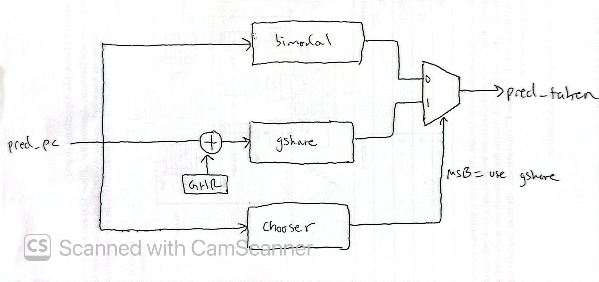

## Summary: 

This project is a tournament branch predictor (bimodal + gshare + chooser) in Verilog. It is verified against a Python reference model across 7 different workloads (700K branches). I swept storage budgets across all three predictors and found that at 0.75 KiB, the tournament predictor reaches **88% average accuracy, reducing mispredictions by 22%** compared two the other two types. I then evaluated it under a pipelined fetch/resolve model, where branches resolve multiple cycles after they are predicted and mispredictions flush junior branches. In that model, non-speculative global history becomes useless and the gshare predictor loses its advantage. To fix this, I implemented **speculative history with a checkpoint-based repair**, which has an accuracy of **88% at a 16-cycle resolve latency vs. 86.5% without it.** For the history-based workload (interpreter), the difference is 97.8% vs 83.3%. 

## How it works

Three tables of **2-bit saturating counters** are read in parallel every cycle:

| Table | Indexed by | Learns |
|---|---|---|
| **Bimodal** | `PC[BIM_BITS+1:2]` | Each branch's overall bias |
| **Gshare** | `PC[GSH_BITS+1:2] ⊕ GHR` | Branch behavior *in the context of recent history* |
| **Chooser** | `PC[CHO_BITS+1:2]` | Per branch, which of the two to trust |

The chooser's MSB selects gshare or bimodal for the final prediction. On resolve, both component counters train toward the actual outcome. The chooser trains **only when the components disagreed**, moving toward whichever was right.

**Predictor metadata.** Predictions are made at fetch, but outcomes arrive many cycles later, so each prediction carries a 64-bit metadata word down the pipeline: `{zeros, pg, pb, GHR}`. At resolve, the update uses the *saved* GHR to train the exact gshare counter that made the prediction, and the *saved* component predictions to train the chooser, even if the tables and history have changed since.

**Speculative history with repair (`SPEC_HIST = 1`).** With non-speculative history, the GHR only updates at resolve, so younger branches are predicted with history that is missing every branch still in flight. With speculation on, the GHR shifts in the **predicted** direction at fetch. On a mispredict, it is **repaired** from the branch's checkpoint (the GHR saved in its metadata), shifted with the actual outcome. Younger wrong-path branches are flushed, so only the oldest mispredicted branch ever repairs. This is the same idea as rename-map checkpointing in an out-of-order core. The counter tables still update non-speculatively at resolve, since they're too large to checkpoint and wrong-path updates would pollute them.

**Verification.** A cycle-level testbench drives each design with branch traces and models predict-at-fetch, update-at-resolve, configurable resolve latency, up to 32 in-flight branches, and flush-and-refetch on mispredict. Every prediction is compared against a Python reference model, and every number below comes from a run that matched it **bit-for-bit**.

## Results

### Accuracy vs. storage

| Predictor | Storage | Mean accuracy | `interp` | `cfg_large` | `bsearch` |
|---|---|---|---|---|---|
| Bimodal | 0.12 KiB | 85.6% | 77.0% | 78.5% | 80.8% |
| Bimodal | 8 KiB | 85.6% | 77.0% | 78.5% | 80.8% |
| Gshare | 0.5 KiB | 84.0% | 95.8% | 59.9% | 80.2% |
| Gshare | 8 KiB | 86.3% | 99.9% | 59.5% | 80.2% |
| **Tournament** | **0.75 KiB** | **88.8%** | **97.8%** | **78.7%** | 80.8% |
| Tournament | 12 KiB | 89.8% | 99.9% | 79.4% | 80.9% |

### Accuracy vs. branch resolve latency

Tournament with 10-bit tables, up to 32 branches in flight:

| Resolve latency | Non-speculative GHR | Speculative GHR + repair | `interp` (non-spec → spec) |
|---|---|---|---|
| 1 cycle | 88.8% | 88.8% | 97.8% → 97.8% |
| 4 cycles | 89.0% | 88.8% | 99.8% → 97.8% |
| 8 cycles | 88.4% | 88.8% | 91.5% → 97.8% |
| 16 cycles | 86.5% | **88.8%** | 83.3% → **97.8%** |

Speculative history makes accuracy **independent of resolve latency**, while non-speculative history degrades as more branches are in flight. The history-correlated `interp` workload is hit hardest (−14.5 points at 16 cycles).

## Analysis: 

**How do the bimodal and gshare predictors perform?**
When looking at the accuracy vs. storage plot (capacity.png), the bimodal predictor saturates at 0.12 KiB, where it remains at an accuracy of 85.6%. This is because at this point, every static branch has its own counter (there is no aliasing to remove) and the remaining mispredictions come from branches with outcomes that depend on context rather than the PC. Gshare has the opposite behavior, performing worse than bimodal at smaller budgets (81.4% at 0.03 KiB) because each static branch is spread across many (PC, history) table entries so it needs a greater capacity and longer warm-up. It overtakes the bimodal predictor at around 2 KiB and continues to increase in accuracy (86.3% at 8 KiB). 

**Why is the tournament predictor advantageous?**
From the plot, the tournament predictor's chooser clearly picks the right component per branch. On interp (a bytecode dispath loop where all branches are correlated with recent history), the tournament reaches a 97.8% accuracy vs the bimodal's 77.0% accuracy by trusting the gshare predictor. On cfg_large (512 static branches that are capacity-bound), it reaches a 78.7% accuracy vs the gshare's 59.9% accuracy by trusting the bimodal predictor. On bsearch (binary search), all three predictors sit at around 81% accuracy because binary search directions are data-dependent, making them unpredictable. 

**How do they perform at equal storage?**
At 0.75 KiB the tournament reaches a 88.8% mean accuracy, which is +3.2 points over the best single predictor at a similar budget (bimodal, 85.6%). That is 22% fewer mispredictions (14.4% → 11.2% miss rate). It also beats gshare at 8 KiB (86.3%) despite using about one-tenth of the storage.

**What size would I ship?**
I would ship the 10-bit configuration, which uses 0.75 KiB with an accuracy of 88.81%. This is because the following increase in storage up to 3 KiB only increases the accuracy by 0.15%. The 12 KiB configuration reaches an accuracy of 89.83%, but most of that gain comes from the loop-heavy workloads (matmul, interp), which benefit from the longer global history. For those workloads, a hybrid with a loop predictor or TAGE predictor would work just as well for cheaper. 

## Synthesis

I synthesized with **Yosys** (`synth_xilinx`, Xilinx 7-series / Artix-7 target) at the default 10-bit table configuration (6,154 bits of predictor state):

| | `SPEC_HIST = 0` | `SPEC_HIST = 1` |
|---|---|---|
| Logic LUTs | 103 | 137 |
| LUTRAM (`RAM128X1D`) | 48 | 48 |
| Flip-flops | 10 | 10 |

- **All three counter tables map to distributed RAM (LUTRAM).** The predict port needs a same-cycle (asynchronous) read, which block RAM can't provide, since its read is registered. 48 × 128-bit primitives = 6,144 bits, exactly the three 1,024 × 2-bit tables.
- **The only flip-flops are the 10-bit GHR.** The tables are initialized at configuration time rather than reset, which keeps them in RAM instead of thousands of registers.
- **Speculative history costs +34 LUTs (+33% logic) and no extra storage.** The GHR's next-state logic now selects between repair (from the checkpoint in the metadata), speculative shift, and hold. It also puts the full predict path (index → table read → chooser mux) in front of the GHR flop, which makes it the likely critical path.

*Yosys doesn't do place-and-route, so there's no Fmax yet. Running the included Vivado script (`synth/synth.tcl`) for timing is a next step.*

